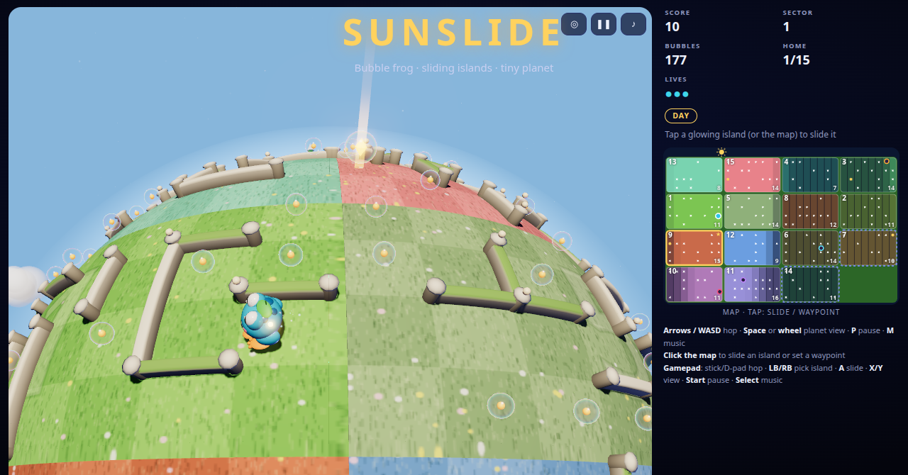

# Sunslide



**[Play live](https://carlok.github.io/sunslide/)** · Pac-Man-style bubble chasing on a **15-puzzle of sliding meadow islands** wrapped around a tiny planet, with day/night, bats, sinkholes, and Pip the bubble frog.

[](https://github.com/carlok/sunslide/actions/workflows/ci.yml)
[](https://github.com/carlok/sunslide/blob/main/LICENSE)

Contributing: [CONTRIBUTING.md](CONTRIBUTING.md) · Security: [SECURITY.md](SECURITY.md) · Conduct: [CODE_OF_CONDUCT.md](CODE_OF_CONDUCT.md)

## Controls

| Action | Touch | Keyboard / mouse | Gamepad |
|--------|-------|------------------|---------|
| Move | Swipe on the planet or D-pad | Arrows / WASD | Stick / D-pad |
| Slide island (sunlit, adjacent to empty meadow) | Tap island or map | Click | LB/RB pick, **A** slide |
| Waypoint | Tap non-adjacent map tile | Click map | — |
| Planet view | ◎ / VIEW | Space, wheel | X / Y |
| Pause | ❚❚ | P / Esc | Start |
| Music | ♪ | M | Select |

Phones vibrate; controllers rumble on big events.

## Development

```bash
npm ci
npm run dev          # http://localhost:5173/sunslide/
npm run build        # dist/ for GitHub Pages
npm test             # Vitest + coverage (src/logic) + Playwright smoke
npm run hero         # refresh assets/hero.png (needs build first)
```

Playwright needs a one-time browser install: `npx playwright install chromium`.

### Project structure

```
src/logic/           Pure game logic (Vitest, v8 coverage thresholds)
src/game/frags/      Render, audio, UI slices (concatenated at build time)
src/main.js          Entry
tests/smoke.mjs      Headless gameplay + layout checks on production build
.github/workflows/   CI on PRs; Pages deploy on main
assets/hero.png      og:image + README hero (from npm run hero)
```

## CI & coverage

On every PR and push to `main`, CI runs ESLint, `vite build`, **Vitest** on `src/logic/` (about **90%+** line coverage on movement/maze/light), and the **Playwright** smoke test against `vite preview`.

Pushes to `main` also deploy `dist/` to GitHub Pages at `/sunslide/`.

**One-time repo setup:** GitHub **Settings → Pages → Build and deployment → Source: GitHub Actions** (if Pages is not already wired to the workflow).

## Docs

- [Game design & tuning](docs/GAME_DESIGN.md)
- [CLAUDE.md](CLAUDE.md) — architecture for agents and contributors

## Credits

**Sunslide** — hop as Pip the bubble frog on a tiny planet: a sunlit **15-puzzle of sliding meadow islands**. © [carlok](https://github.com/carlok). Source: [Apache-2.0](LICENSE). Built with [three.js](https://threejs.org/) (MIT) and Vite.

**Korean UI** (`ko`): based on the Apache-2.0 fork [sigco3111/sunslide-ko](https://github.com/sigco3111/sunslide-ko); see [NOTICE](NOTICE).

### Languages

The game ships **English**, **Italian**, and **Korean**. Locale follows the browser (`navigator.languages`), with optional override via `?lang=en|it|ko` or the language setting in the menu (stored in `localStorage`).

## Licence

Sunslide source is licensed under **Apache-2.0** ([LICENSE](LICENSE)). **three.js** is [MIT](https://github.com/mrdoob/three.js/blob/dev/LICENSE) via npm.